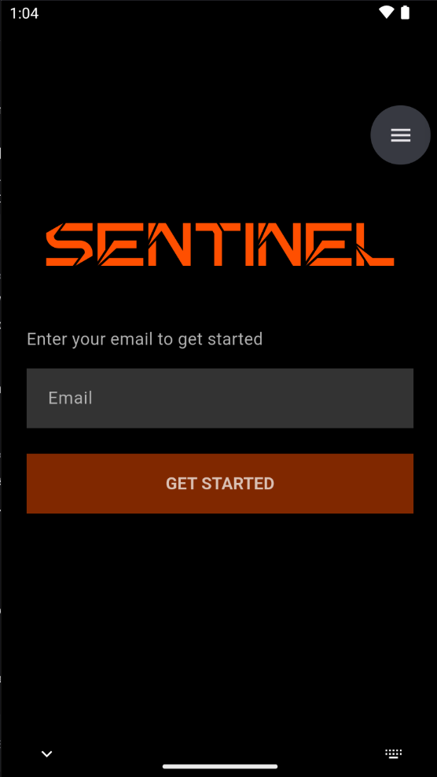
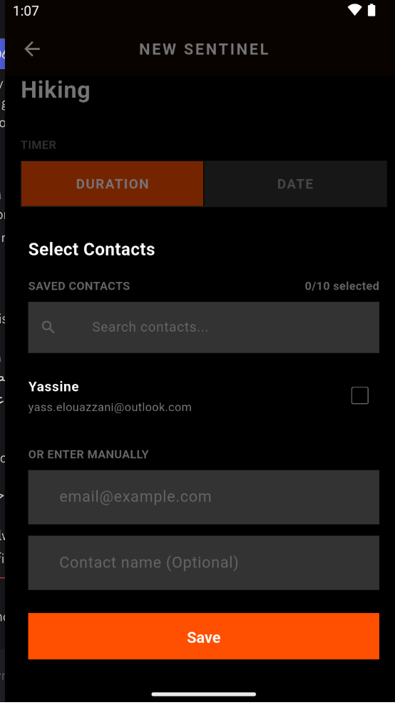
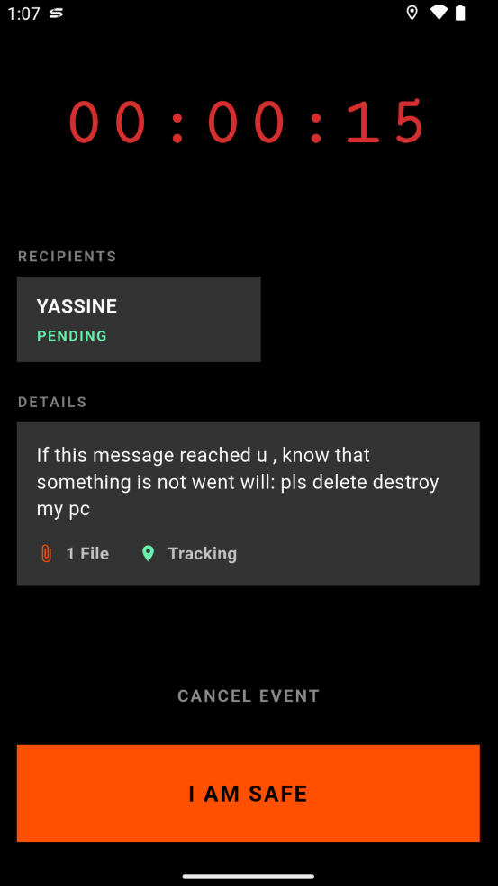
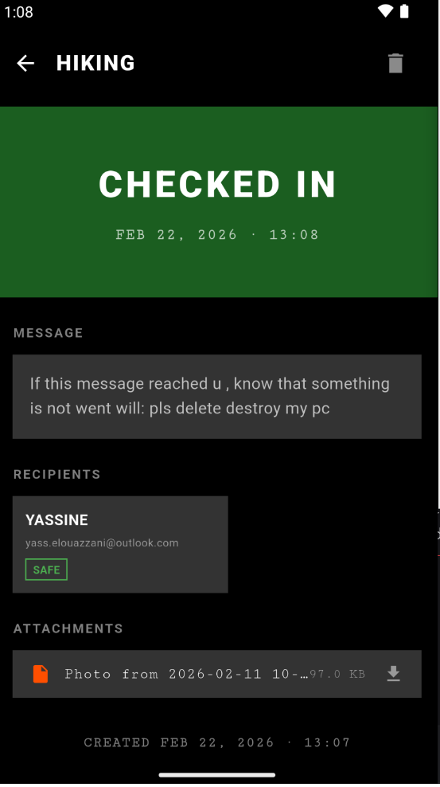

# Sentinel Mobile App

  
  
  
  
  

A sophisticated personal safety companion. Sentinel is the official Flutter mobile client built to interface seamlessly with the highly reliable Sentinel Core API. It empowers users to establish timed safety events, tracks precise GPS coordinates in the background, and securely dispatches emergency alerts containing critical location data and file attachments if a check in is missed.

## Key Features

* **Passwordless Authentication** A frictionless, highly secure OTP based login flow ensures immediate access without the vulnerability of stored passwords.
* **Resilient Background Timers** Engineered using native Android foreground services, the timer infrastructure guarantees countdown execution even when the application is completely swiped from memory or the device is locked.
* **Persistent Location Tracking** Continuous background GPS polling synchronizes your precise coordinates with the server during any active event.
* **Emergency Contact Management** A robust, built in address book allows you to add, edit, and select trusted contacts to be notified in an emergency.
* **Secure File Attachments** Upload sensitive documents, photos, or seed phrases that will be securely relayed to your contacts exclusively upon timer expiry.
* **Comprehensive Internationalization** Native support for English, Arabic, Spanish, French, and Chinese. The UI dynamically adjusts to Right To Left layouts for Arabic.
* **Premium Aesthetics** A refined dark mode UI featuring high contrast Sentinel Orange accents and custom typography designed for optimal readability in high stress situations.

## Technical Architecture

The codebase adheres strictly to a feature driven architecture, maximizing modularity, maintainability, and scalability.

### Core Technology Stack

* **Framework** Flutter SDK 3.10 and above
* **Language** Dart
* **State Management** Riverpod for reactive caching, dependency injection, and scalable state isolation.
* **Routing** GoRouter for declarative, deep linkable navigation.
* **Networking** Dio HTTP client enriched with robust interceptors for token management.
* **Storage** Flutter Secure Storage for encrypted JWT token persistence and Shared Preferences for lightweight application settings.

### Directory Structure Overview

* `lib/core/` Houses global utilities, API configurations, the GoRouter setup, custom theming engines, and native platform method channels.
* `lib/features/` Contains completely isolated, highly cohesive modules for Authentication, Dashboard, Events, Contacts, File Uploads, and Settings.
* `lib/l10n/` Stores ARB translation dictionaries enabling flawless multi language support.

## Getting Started

### Prerequisites

* Flutter SDK version 3.10 or higher
* Android Studio or Visual Studio Code
* An active, reachable instance of the [Sentinel Core API](https://github.com/Yass5002/sentinel-core-api)

### Installation Guide

1. Clone this repository to your local machine.
2. Execute `flutter pub get` to resolve and install all necessary dependencies.
3. Update the backend URL environment variable in `lib/core/network/api_constants.dart` to point to your specific API instance.
4. Launch the application using `flutter run` on your preferred emulator or physical device.

## System Dependencies

* [Sentinel Core API](https://github.com/Yass5002/sentinel-core-api) The high performance backend server powering this mobile application.

## License

© 2026 Yass5002. All rights reserved. See [LICENSE](./LICENSE).

